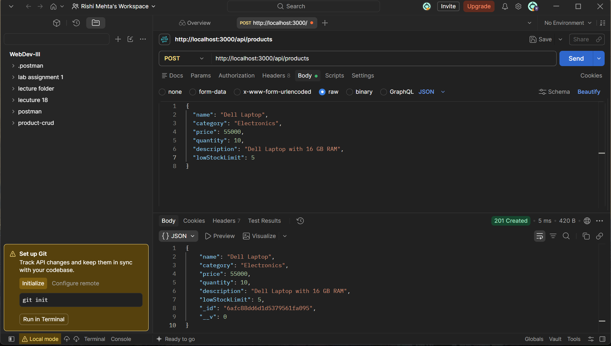
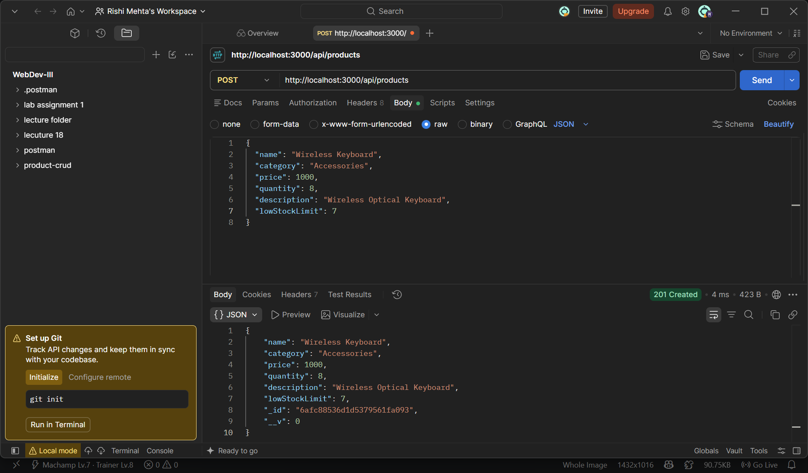
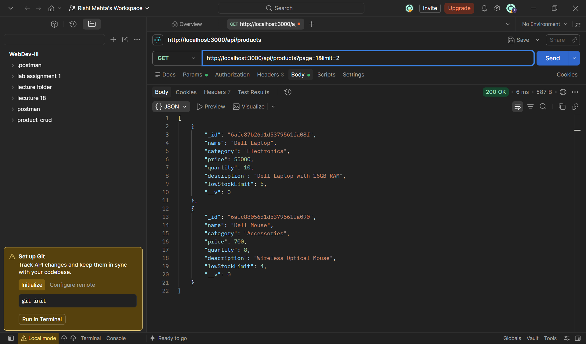
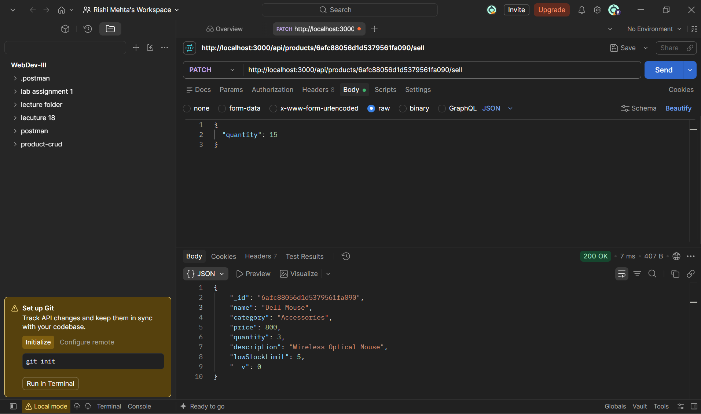
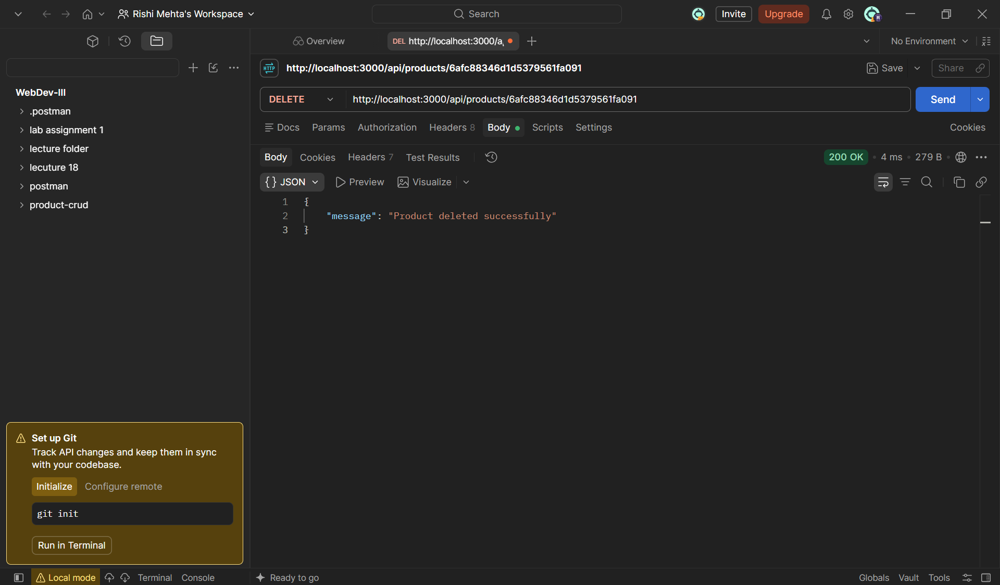
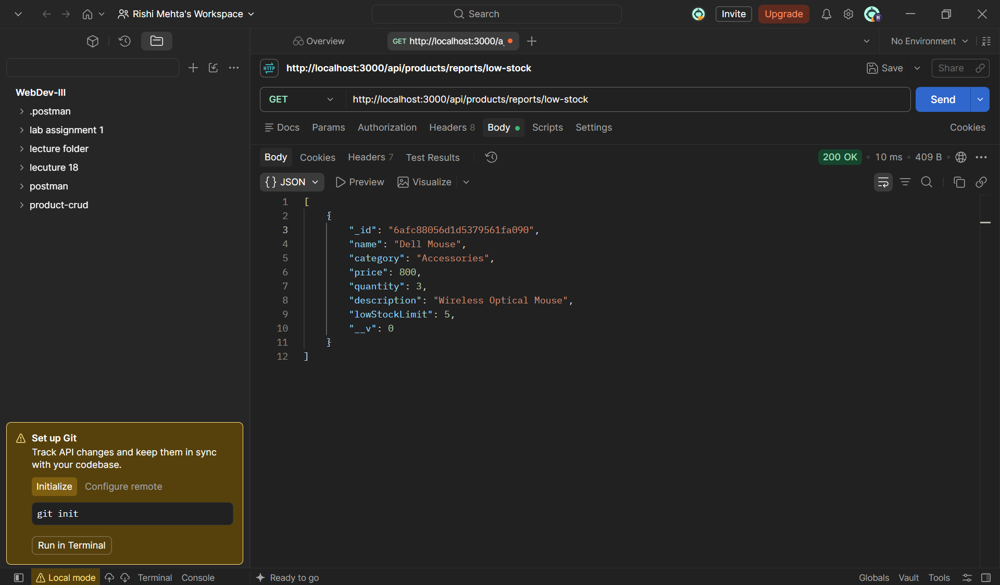

# Inventory and Data Management System

## About the Project

A simple Inventory and Data Management System built using Node.js, Express.js, and MongoDB. It allows users to manage products, update stock, sell products, and generate inventory reports.

## Technologies Used

- Node.js
- Express.js
- MongoDB
- Mongoose
- Postman
- dotenv

## Features

- Create, view, update, and delete products.
- Search and filter products.
- Sort and paginate products.
- Restock and sell products.
- Prevent selling more than available stock.
- Generate low-stock reports.
- Generate category-wise inventory reports.
- Product validation and error handling.

## Project Structure

```text
Inventory and Data Management System/
├── model/
├── routes/
├── screenshots/
│   ├── Category Report.png
│   ├── Create_Keyboard.png
│   ├── Create_Laptop.png
│   ├── Create_Mouse.png
│   ├── delete.png
│   ├── get all product.png
│   ├── LowStock_Report.png
│   ├── pagination.png
│   ├── product by id.png
│   ├── Sell.png
│   └── Update Value.png
├── .env
├── .env.example
├── .gitignore
├── package-lock.json
├── package.json
├── README.md
└── server.js
```

## Installation and Setup

### 1. Clone the Repository

```bash
git clone YOUR_GITHUB_REPOSITORY_LINK
```

### 2. Install Dependencies

```bash
npm install
```

### 3. Configure Environment Variables

Create a `.env` file in the root directory.

```env
PORT=3000
MONGO_URI=your_mongodb_connection_string
```

### 4. Start the Server

```bash
node server.js
```

## API Documentation

**Base URL:**

```text
http://localhost:3000/api/products
```

### 1. Create Product

- Method: `POST`
- Endpoint: `/api/products`

**Request Body:**

```json
{
  "name": "HP Laptop",
  "category": "Electronics",
  "price": 55000,
  "quantity": 10,
  "description": "HP Laptop with 8GB RAM",
  "lowStockLimit": 5
}
```

### 2. Get All Products

- Method: `GET`
- Endpoint: `/api/products`

### 3. Filter Products

- Method: `GET`
- Endpoint: `/api/products?category=Electronics`

### 4. Search Products

- Method: `GET`
- Endpoint: `/api/products?search=Laptop`

### 5. Sort Products

- Method: `GET`
- Endpoint: `/api/products?sort=price`

Use `sort=-price` for descending order.

### 6. Pagination

- Method: `GET`
- Endpoint: `/api/products?page=1&limit=5`

### 7. Get Product by ID

- Method: `GET`
- Endpoint: `/api/products/:id`

### 8. Update Product

- Method: `PUT`
- Endpoint: `/api/products/:id`

**Request Body:**

```json
{
  "name": "HP Laptop Updated",
  "category": "Electronics",
  "price": 60000,
  "quantity": 15,
  "description": "Updated HP Laptop",
  "lowStockLimit": 5
}
```

### 9. Restock Product

- Method: `PATCH`
- Endpoint: `/api/products/:id/restock`

**Request Body:**

```json
{
  "quantity": 10
}
```

### 10. Sell Product

- Method: `PATCH`
- Endpoint: `/api/products/:id/sell`

**Request Body:**

```json
{
  "quantity": 4
}
```

### 11. Delete Product

- Method: `DELETE`
- Endpoint: `/api/products/:id`

### 12. Low Stock Report

- Method: `GET`
- Endpoint: `/api/products/reports/low-stock`

### 13. Category-wise Inventory Report

- Method: `GET`
- Endpoint: `/api/products/reports/category`

## API Testing Screenshots

All API endpoints were tested using Postman.

### 1. Create Products

**Create Laptop**



**Create Mouse**


**Create Keyboard**



### 2. Get All Products


### 3. Pagination



### 4. Get Product by ID


### 5. Update Product


### 6. Sell Product



### 7. Delete Product



### 8. Low Stock Report



### 9. Category-wise Inventory Report

